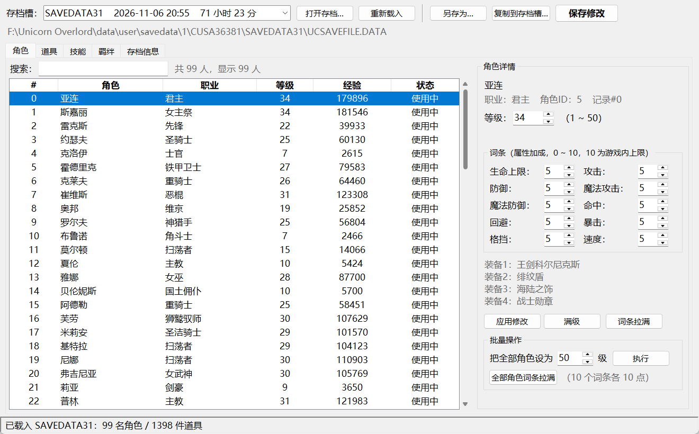

# Unicorn Overlord 存档修改器

针对 **Unicorn Overlord（圣兽之王）PS4 移植版**（社区移植项目 `hachi23/unicorn_overlord_pc`）的**离线存档修改器**，带中文界面。

只读写游戏存档文件 `UCSAVEFILE.DATA`，**不修改游戏本体、不需要注入内存、不需要联网**。



## 功能

| 模块 | 能做什么 |
| --- | --- |
| 角色 | 等级（1~50）、经验、10 项词条（属性加成 0~10）、查看装备与状态；单角色「满级 / 词条拉满」，批量「全部角色设为 N 级 / 全部角色词条拉满」 |
| 道具 | 1400+ 条背包记录，中文道具名；修改数量（0~999），或把同种道具的所有堆叠一起改 |
| 技能 | 查看每个角色 16 个技能/战术槽（主动/被动技能、条件→技能战术），可把已有技能槽换成别的技能（**实验性**） |
| 羁绊 | 查看/修改角色间亲密度（0~900）与羁绊事件数；「本角色对所有人拉满」「全员相互拉满」；自动排除佣兵（无剧情的自定义 NPC） |
| 存档信息 | 存档时间、游戏时长、金钱（0x20）、名声（0x24） |

界面截图：[道具页](docs/images/items.png) · [技能页](docs/images/skills.png) · [羁绊页](docs/images/bonds.png)

## 环境要求

- Windows（在 Windows 10/11 + Python 3.14 上实测）
- Python 3.8+，需要 `tkinter`（Windows 官方安装包自带，无需 pip 安装任何东西）
- 游戏存档目录（移植版的 `data/user/savedata/1/CUSA36381/`）

## 使用

1. 把本仓库放到任意位置（例如 `D:\Tools\UO-Save-Editor`）。
2. 双击 `启动修改器.cmd`，或命令行运行 `python UOEditor.py`。
3. 程序会自动寻找存档目录，找不到时：
   - 在 `config.json` 里填 `savedata_dir`（参考 `config.example.json`），或
   - 设置环境变量 `UO_SAVEDATA_DIR`，或
   - 点界面上的「打开存档…」手动选 `UCSAVEFILE.DATA`。
4. 改完点「保存修改」。原文件会先备份到程序目录的 `backups\`。

也可以直接用命令行打开某个存档：

```
python UOEditor.py "D:\...\savedata\1\CUSA36381\SAVEDATA31\UCSAVEFILE.DATA"
```

### 存档位置

```
<游戏目录>\data\user\savedata\1\CUSA36381\SAVEDATA0..31\UCSAVEFILE.DATA
                                    \SAVEDATA{n}.sce_sys\param.bin   (元数据，本工具不修改)
```

游戏每次启动时也会自动把整个 `savedata` 备份到 `data\user\savedata_backups\<时间戳>\`（保留最近 10 份）。

## 安全性

- 该存档格式**没有校验和/签名**（PS4 的签名信息在旁边的 `param.bin` 里，本工具不碰），改完直接覆盖即可被游戏读取。
- 写入前自动备份原文件 → `backups\<槽名>_<时间戳>_UCSAVEFILE.DATA`，还原时拷回去即可。
- 写入采用「临时文件 + 原子替换」，并校验文件长度为 `5,109,536` 字节。
- 建议**关闭游戏或退到标题画面**后再改档，改完重新读档。

## 存档结构（供参考）

存档是未压缩、未加密的扁平小端结构：

| 字段 | 偏移 | 说明 |
| --- | --- | --- |
| 角色数组 | `0x2AF40` | 每条 464 字节，`ID == 0xFFFFFFFF` 结束 |
| 经验 Exp | 记录 +0x38 | u32，累计值；等级由经验表决定 |
| 等级 Lv | 记录 +0x3C | u16，上限 50 |
| 词条 | 记录 +0x40..+0x49 | 10 × u8（生命/攻击/防御/魔攻/魔防/命中/回避/暴击/格挡/速度） |
| 装备 | 记录 +0x4C..+0x5B | 4 × u32，存的**是背包记录序号**，需二次查表得到道具 ID |
| 技能/战术槽 | 记录 +0x5C 起 | 16 个 16 字节槽，空槽 `(0,0,0xFFFF,0)` |
| 背包记录 | `0xA0` 起 | 每条 20 字节：ID u32、序号 u32、数量 u24、装备标记等 |
| 羁绊记录 | `0x1B5830` 起 | 每条 1316 字节：角色 ID + 8 字节条目（对象 ID、亲密度 u16、事件标记 u16） |
| 金钱 / 名声 | `0x20` / `0x24` | u32 |

面板属性不存档，游戏按「职业基础值 + 成长 + 等级曲线」实时计算，所以改等级/词条就等于改面板。

等级由累计经验决定，各等级经验阈值（共 50 级，50 级需 1,000,000）：

```
Lv2=100  Lv3=300  Lv4=600  Lv5=1000 ... Lv25=37500 ... Lv40=417500 ... Lv49=900000  Lv50=1000000
```

（完整表在 `uo_core.TOTAL`，脚本可 `uo_core.exp_for_level(n)` 查询。）

## 中文词表

`names/*.json` 是从游戏消息表（`MsgSheet/*.fms`）提取的角色/职业/道具/技能/条件中文名，仅用于界面显示。
生成脚本在 `tools/`（需要游戏 CPK，见脚本内说明）；不包含任何游戏资源文件本身。

## 免责声明

- 仅供个人单机存档修改与学习研究使用，请**先备份存档**，修改风险自负。
- 与游戏开发/发行商无关，不含任何游戏本体文件。
- 修改存档可能影响联机/成就等（本移植版为单机），请自行判断。

## License

MIT
